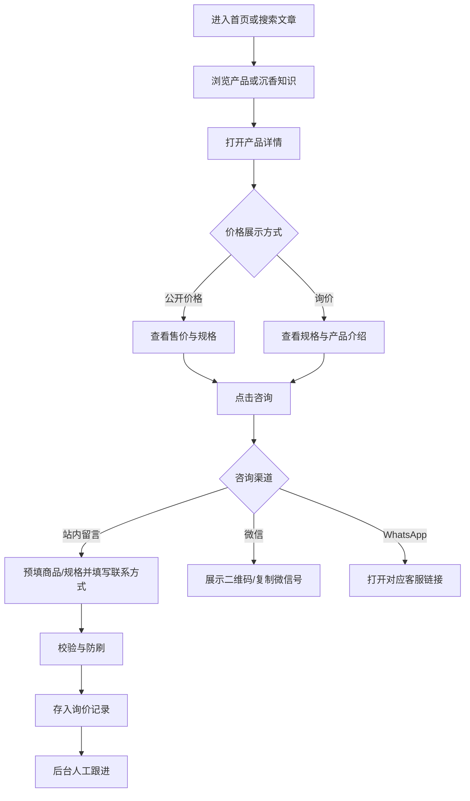
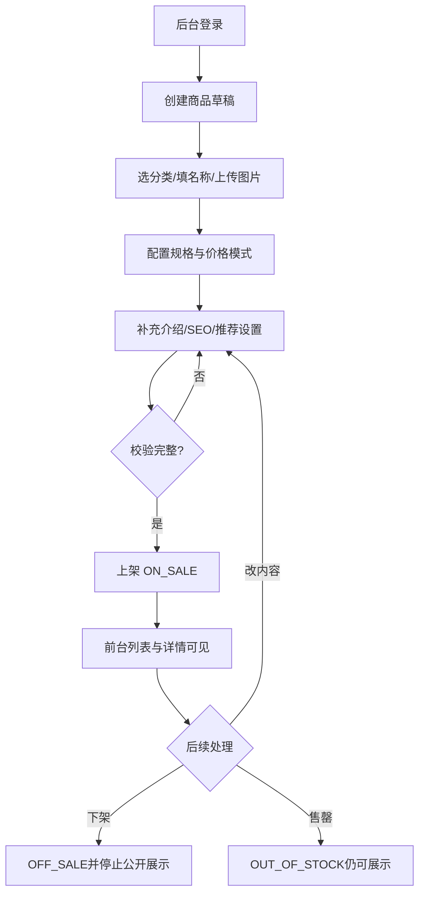

# 沉香品牌官网 V1.0 产品与技术设计文档

> 版本：V1.0（待评审）  
> 日期：2026-11-03  
> 定位：品牌展示 + 产品获客销售  
> 价格策略：部分商品公开价格，部分商品询价  
> 目标读者：业务负责人、UI 设计师、前后端开发（Codex）、测试

---

## 0. 核心决策与待确认项

### 已确定

- 前台以移动端优先，PC 自适应；品牌官网与获客兼顾。
- 商品支持公开标价、询价；可按不同规格配置价格。
- V1.0 必须支持：首页、产品列表/详情、沉香知识列表/详情、关于我们、联系我们；后台产品分类/商品/规格/图片/上下架、文章、首页内容、公司资料、咨询记录和基础 SEO。
- V1.0 不提供在线下单、购物车、在线支付、物流跟踪、会员积分及自动复购营销。
- 采用用户熟悉的 Vue 生态 + FastAPI + MySQL，前台采用具备 SSR/SSG 能力的 Nuxt，后台 Vue 3。

### 开发前可配置或待确认（不阻塞基础开发）

| 项目 | 建议默认值 | 备注 |
|---|---|---|
| 品牌名称 / Logo / 域名 | 占位配置 | 不在代码里写死 |
| 站点语言 | 简体中文 | 后续预留繁体/英文，不在 V1 实现多语言 |
| 币种 | CNY | 单币种 V1，价格单位后台可配置为人民币 |
| 客服渠道 | 微信二维码 + WhatsApp + 电话（均可开关） | 未配置渠道不展示 |
| 询价提交 | 站内留言表单 + 外部客服跳转 | 留言表单需隐私告知与反垃圾机制 |
| 是否显示商品价格 | 规格维度 `FIXED`/`INQUIRY` | 同一商品允许不同规格分别设置 |
| 商品库存 | 只做 `IN_STOCK`/`OUT_OF_STOCK` 展示状态 | 不做库存扣减、入出库 |
| 产品原料/产地证据 | 能证明才展示 | 不默认标注“天然”“奇楠”“野生”等真实性断言 |

## 1. 项目目标、用户与边界

### 1.1 商业目标

1. **建立信任**：真实呈现公司介绍、产品资料、服务方式和联系渠道。
2. **高质量展示**：分类展示沉香切块、勾丝、香粉、线香、手串、摆件及香具等；每件商品可维护多图、规格与询价方式。
3. **获得询盘**：从产品详情、文章、首页到客服形成闭环，记录站内留言的来源商品/来源页面。
4. **降低维护成本**：运营人员在后台修改产品、上下架、文章、首页内容、联系方式，无需发布代码。
5. **支持自然搜索**：重要内容具备独立 URL、服务端可抓取内容、基本 metadata 与 sitemap。

### 1.2 典型用户

- 初次接触沉香：先看沉香科普与使用场景，再查看适合入门的商品。
- 有明确购买目的：按商品分类找切块、勾丝、线香、手串等，查看价格/规格并询价。
- 已有沉香经验：快速看材质、原料来源、香韵描述、实拍图、规格和价格状态。
- 运营管理员：快速发布图文、上下架商品、管理首页及处理客户咨询。

### 1.3 不在 V1.0 范围

- 在线订单、支付、优惠券、购物车、会员账户、物流跟踪、自动补货。
- 大型 CRM、营销自动化、复杂多角色审批、分销、团购、直播。
- 多币种/多语言、多仓库存、重量自动计价、跨境电商报关。
- 未经核实的“治疗失眠、镇静、疗效保证”等医疗功效宣传。

## 2. 信息架构与页面清单

```text
前台网站
├── /                         首页
├── /products                 产品中心
│   └── /products/{slug}      产品详情
├── /knowledge                沉香知识
│   └── /knowledge/{slug}     文章详情
├── /about                    关于我们
├── /contact                  联系我们
├── /privacy                  隐私政策
├── /terms                    网站使用条款（可简化）
└── /404                      页面不存在

管理后台（独立 /admin 路由空间，访问鉴权）
├── /admin/login              登录
├── /admin/dashboard          概览（简单统计）
├── /admin/products           产品管理
├── /admin/categories         商品分类
├── /admin/media              素材库
├── /admin/articles           知识文章管理
├── /admin/home               首页配置 / Banner
├── /admin/site               公司资料 / SEO / 联系方式
└── /admin/inquiries          留言询价管理
```

### 2.1 全站公用元素

- 顶部：品牌 Logo、导航（产品中心、沉香知识、关于我们、联系我们）。移动端折叠菜单。
- 底部：公司名称、简要介绍、联系方式、隐私政策、版权及备案信息（如适用）。
- 浮动客服：微信二维码弹层 / WhatsApp 跳转（仅对已配置渠道可见）。
- 面包屑：产品详情、文章详情使用。
- 全站页面不能只依赖浏览器 JS 才显示主要内容；应可被常见搜索爬虫获取。

### 2.2 首页 `/`

按顺序：

1. 主视觉 Banner（品牌定位、主图、CTA“了解产品”或“咨询客服”）。
2. 品牌一句话介绍（3 个特色点；使用可核实表述）。
3. 精选产品（后台选择 4～8 个，没选择则按排序与发布时间兜底）。
4. 产品分类入口（分类图 + 分类名称）。
5. 沉香使用场景（茶席品香、书房、礼赠等，V1 可由首页富文本/固定模块配置）。
6. 沉香知识精选（3～4 篇，跳文章详情）。
7. 公司介绍摘要 / 经营优势（可链接关于我们）。
8. 联系 CTA（微信、WhatsApp、留言）。

**空状态规则**：没有 Banner 时使用预置品牌首屏；没有精选产品时模块隐藏或展示最新在售产品，不能空白报错。

### 2.3 产品中心 `/products`

- 分类筛选（全部、切块/碎料、勾丝/香粉、线香/盘香、手串、挂件/摆件、香具/礼盒，后台可调整）。
- 关键词搜索：商品名称、简要描述；支持 URL 查询参数 `category`、`q`、`page`。
- 排序：推荐优先（默认）、最新发布。
- 卡片显示：封面、名称、短描述、价格显示态（`¥xx起` 或 `价格面议`）、在售/售罄标签。
- 每页 12 项，支持分页，移动端可使用“加载更多”但 URL 分页仍可访问。
- 只显示 `ON_SALE` 的产品；`OUT_OF_STOCK` 商品仍可展示但标“暂时售罄”，咨询按钮可按后台策略保留。

### 2.4 产品详情 `/products/{slug}`

- 主图与多图轮播（支持放大）；商品名称、SKU/编号、短描述。
- 可选规格（如 1g、5g、10g）：切换规格时更新对应价格文案、状态和商品编号。
- 价格呈现：公开价格显示 `¥xxx`；询价显示 `价格面议`；不出现“¥0”。
- 商品详情：图文、香气特点、推荐场景、使用方法及注意事项、来源说明（可选）、相关产品。
- 咨询 CTA：`咨询该商品`，打开表单并预填商品与规格；微信扫码、WhatsApp（如启用）可同时存在。
- SEO：产品独立 canonical、标题、描述、分享图；后台可设 SEO 内容，否则自动由名称/简介生成。
- 商品下架：前台列表不显示；详情原 URL 返回 404（或运营显式设置 301 到替代商品，V1 不做重定向管理）。

### 2.5 沉香知识 `/knowledge` 与文章详情

- 文章分类建议：基础入门、使用方法、产品选择、文化知识；V1 使用固定枚举或简单字符串分类。
- 列表：封面、标题、摘要、发布时间，支持分页和关键词。
- 详情：标题、发布日期、封面、正文图文、相关文章、关联商品、联系 CTA。
- 支持草稿与发布；草稿内容不得通过公共 API 泄漏。
- 建议首批文章标题（问题/任务型）：《第一次接触沉香，应该怎么选？》《沉香切块和勾丝怎么使用？》《电熏炉与线香有什么区别？》《什么是奇楠？购买前需要注意什么？》

### 2.6 关于我们 `/about`

- 品牌故事、公司介绍、业务范围、主营品类、经营理念。
- 可核实的原料来源、实拍经营场景、资质信息（有则展示）。
- 联系入口，不展示无法证明的权威认证或稀缺性保证。

### 2.7 联系我们 `/contact`

- 微信号、二维码、WhatsApp、电话、电子邮箱、联系地址等均按后台配置决定显示。
- 站内留言表单：称呼、手机号/邮箱/微信至少一种联系方式、留言、意向商品和规格（可为空）、隐私同意。
- 提交成功显示受理提示；不承诺未配置的响应时效。
- 基础反垃圾：限流、蜜罐字段/验证码策略、长度限制；后台仅受授权人员可见留言信息。

## 3. 核心业务规则

### 3.1 商品状态与可见性

| 字段 | 值 | 行为 |
|---|---|---|
| `status` | `DRAFT` | 仅后台可见 |
| `status` | `ON_SALE` | 前台可见、可咨询 |
| `status` | `OFF_SALE` | 仅后台可见；公共详情返回 404 |
| `stock_status` | `IN_STOCK` | 在售时正常展示 |
| `stock_status` | `OUT_OF_STOCK` | 在售时标注“暂时售罄”；不代表下架 |

商品必须满足：名称、slug、分类、封面、至少 1 个启用规格、必要介绍，才允许从草稿上架。下架不删除数据。

### 3.2 规格与价格

- 一件商品可以有多个规格，如 `1克体验装`、`5克装`；每个规格独立价格模式 `FIXED` 或 `INQUIRY`。
- `FIXED` 必须填写非负金额（业务建议正数），`INQUIRY` 金额必须为空。
- 商品列表价格：若任何在售规格是 `FIXED`，展示其最低公开价 `¥X起`；若全部为询价，展示 `价格面议`。
- 若所有规格缺货，商品显示售罄；V1 推荐采用商品级 `stock_status`，不做规格级库存，避免展示冲突。规格级 SKU/启用状态仍保留。
- 价格及询价为展示/线索，不构成自动订单确认；最终成交以客服确认为准。

### 3.3 内容发布

- 文章 `DRAFT` / `PUBLISHED`；发布时间为实际发布时记录；撤回后公共访问返回 404。
- Banner `is_enabled` 控制是否展示，按 `sort_order` 排序；外部链接白名单 `https://`，站内链接使用相对路径。
- 首页推荐产品必须是 `ON_SALE`；关联商品下架时自动在公共页面过滤。
- slug 站内唯一；已发布商品尽量不要更改 slug，避免旧链接失效。

## 4. 关键用户流程

### 4.1 消费者发现 → 产品咨询



说明：微信扫码及 WhatsApp 外跳一般无法可靠获知最终成交，V1 可记录匿名渠道点击事件但不作为“有效询盘”；真正可跟进的线索以站内表单为准。

### 4.2 运营发布产品



### 4.3 运营文章发布 / 线索处理

- 文章：新建草稿 → 上传封面和插图 → 编辑正文 → 关联商品 → 设置 SEO → 发布 → 前台显示。
- 询价：`NEW` → `CONTACTED` → `CLOSED`；后台可记录内部备注、处理时间，避免在前台公开个人信息。

## 5. 页面视觉与交互设计规范

### 5.1 视觉方向

- 关键词：自然木质、东方审美、克制、有信任感，不采用满屏“玄学疗效/高回报收藏”话术。
- 建议色：米白 `#F7F4ED`、深褐 `#3A2B24`、松绿 `#365047`、金棕点缀 `#A98458`。
- 文字：正文使用易读中文系统字体；大标题可少量使用宋体风格字体；注意字体授权与加载性能。
- 图片：优先真实商品实拍、微距纹理和真实使用场景；图片比例统一，避免大面积文字叠图。
- 手机：单列内容、2 列商品卡片；PC：内容最大宽度约 1200px、3～4 列商品卡片。

### 5.2 首页线框（文字版）

```text
[LOGO] [产品] [沉香知识] [关于我们] [联系]
┌──────────────────────────────┐
│ 品牌主视觉图                  │
│ 一句话品牌定位                │
│ [了解产品] [联系我们]         │
└──────────────────────────────┘
[品牌简介 / 特色 3 项]
[产品分类导航]
[精选产品卡片 × 4~8]
[品香场景：茶席 / 书房 / 礼赠]
[沉香知识文章 × 3~4]
[关于我们摘要]
[咨询 CTA]
[页脚]
[移动端悬浮客服]
```

### 5.3 交互细节

- 图片懒加载、骨架屏、网络错误重试；原图查看、键盘可操作的轮播控件。
- 列表分页及筛选写入 URL，刷新与分享后状态不丢失。
- 提交表单禁用重复点击；成功/失败均有明确反馈。
- 后台保存草稿与正式发布分开，删除操作二次确认；可优先采用软删除/限制删除已有关联的分类。
- 微信扫码弹窗移动端可复制微信号或长按识别二维码；不假设浏览器一定支持跳转微信。

## 6. 技术方案与目录建议

### 6.1 系统构成

```text
Browser
  ├── Nuxt 前台（SSR/SSG，公开页面）
  └── Vue 3 + Vite 管理后台（SPA，仅授权访问）
                 │
                 ▼
          Nginx HTTPS 反向代理
                 │
                 ▼
         FastAPI /api/v1
            ├── 业务服务
            ├── MySQL 8
            └── 本地持久化图片目录 /uploads (后续可换对象存储)
```

建议使用 `Docker Compose` 部署。图片使用独立卷持久化；数据库备份和上传文件备份必须成套执行。

### 6.2 推荐栈

| 层次 | 建议 | 理由 |
|---|---|---|
| 公开前台 | Nuxt（Vue 3）+ TypeScript | SSR/静态生成、SEO、分享元信息 |
| 管理后台 | Vue 3 + Vite + TypeScript + 组件库 | 管理表单与列表高效开发 |
| API | FastAPI + Pydantic + SQLAlchemy 2.x + Alembic | 与现有能力匹配 |
| 数据库 | MySQL 8.x utf8mb4 | 结构化内容、商品、询价 |
| 图片 | 本地持久化文件 + `/uploads` URL | V1 低成本，接口抽象以便迁移 OSS/S3 |
| 身份认证 | 管理员登录 + 服务端 session 或 HttpOnly Secure Cookie | 避免把长期令牌暴露给前端 JS |
| 反向代理 | Nginx + HTTPS | 静态资源缓存、路由分发、上传限制 |

可选仓库结构：

```text
agarwood-site/
├── web/                  # Nuxt 公开站点
├── admin/                # Vue 后台
├── backend/              # FastAPI
│   ├── app/api/v1/
│   ├── app/models/
│   ├── app/schemas/
│   ├── app/services/
│   ├── app/core/
│   └── alembic/
├── deploy/
│   ├── nginx/
│   └── docker-compose.yml
├── docs/
└── README.md
```

## 7. 数据库设计（MySQL 8）

### 7.1 表清单与关联

| 表名 | 用途 |
|---|---|
| `admin_user` | 后台管理员 |
| `media_asset` | 上传图片素材 |
| `product_category` | 产品分类 |
| `product` | 产品主体、状态、介绍 |
| `product_variant` | 规格与询价/固定价格 |
| `product_media` | 商品多图顺序 |
| `knowledge_article` | 沉香知识文章 |
| `article_product` | 文章关联产品 |
| `home_banner` | 首页 Banner |
| `site_setting` | 品牌、公司资料、联系方式、SEO 等配置 |
| `customer_inquiry` | 站内表单询价 |

关系：`product_category 1:N product`；`product 1:N product_variant`；`product 1:N product_media N:1 media_asset`；`knowledge_article N:M product`；`customer_inquiry N:0..1 product/variant`。

### 7.2 SQL 建表语句

> 采用应用层 UUID/雪花 ID 之外的简单自增 BIGINT；日期使用 UTC 存库，展示时按站点时区转换。以下 SQL 是首版逻辑模型，实施时由 Alembic 迁移维护。

```sql
CREATE TABLE admin_user (
    id BIGINT UNSIGNED PRIMARY KEY AUTO_INCREMENT,
    username VARCHAR(64) NOT NULL UNIQUE,
    password_hash VARCHAR(255) NOT NULL,
    display_name VARCHAR(64) DEFAULT NULL,
    is_active TINYINT(1) NOT NULL DEFAULT 1,
    last_login_at DATETIME DEFAULT NULL,
    created_at DATETIME NOT NULL DEFAULT CURRENT_TIMESTAMP,
    updated_at DATETIME NOT NULL DEFAULT CURRENT_TIMESTAMP ON UPDATE CURRENT_TIMESTAMP
) ENGINE=InnoDB DEFAULT CHARSET=utf8mb4;

CREATE TABLE media_asset (
    id BIGINT UNSIGNED PRIMARY KEY AUTO_INCREMENT,
    file_path VARCHAR(512) NOT NULL UNIQUE,
    original_name VARCHAR(255) DEFAULT NULL,
    mime_type VARCHAR(80) NOT NULL,
    file_size BIGINT UNSIGNED NOT NULL,
    width INT UNSIGNED DEFAULT NULL,
    height INT UNSIGNED DEFAULT NULL,
    alt_text VARCHAR(255) DEFAULT NULL,
    created_at DATETIME NOT NULL DEFAULT CURRENT_TIMESTAMP
) ENGINE=InnoDB DEFAULT CHARSET=utf8mb4;

CREATE TABLE product_category (
    id BIGINT UNSIGNED PRIMARY KEY AUTO_INCREMENT,
    name VARCHAR(100) NOT NULL,
    slug VARCHAR(120) NOT NULL UNIQUE,
    description VARCHAR(500) DEFAULT NULL,
    cover_media_id BIGINT UNSIGNED DEFAULT NULL,
    sort_order INT NOT NULL DEFAULT 0,
    is_enabled TINYINT(1) NOT NULL DEFAULT 1,
    created_at DATETIME NOT NULL DEFAULT CURRENT_TIMESTAMP,
    updated_at DATETIME NOT NULL DEFAULT CURRENT_TIMESTAMP ON UPDATE CURRENT_TIMESTAMP,
    CONSTRAINT fk_category_cover FOREIGN KEY (cover_media_id) REFERENCES media_asset(id),
    INDEX idx_category_visible (is_enabled, sort_order)
) ENGINE=InnoDB DEFAULT CHARSET=utf8mb4;

CREATE TABLE product (
    id BIGINT UNSIGNED PRIMARY KEY AUTO_INCREMENT,
    category_id BIGINT UNSIGNED NOT NULL,
    product_code VARCHAR(64) NOT NULL UNIQUE,
    name VARCHAR(200) NOT NULL,
    slug VARCHAR(220) NOT NULL UNIQUE,
    summary VARCHAR(500) DEFAULT NULL,
    description_html MEDIUMTEXT DEFAULT NULL,
    aroma_notes VARCHAR(500) DEFAULT NULL,
    origin_description VARCHAR(500) DEFAULT NULL,
    usage_instructions TEXT DEFAULT NULL,
    safety_notes TEXT DEFAULT NULL,
    status ENUM('DRAFT','ON_SALE','OFF_SALE') NOT NULL DEFAULT 'DRAFT',
    stock_status ENUM('IN_STOCK','OUT_OF_STOCK') NOT NULL DEFAULT 'IN_STOCK',
    is_featured TINYINT(1) NOT NULL DEFAULT 0,
    sort_order INT NOT NULL DEFAULT 0,
    cover_media_id BIGINT UNSIGNED DEFAULT NULL,
    seo_title VARCHAR(255) DEFAULT NULL,
    seo_description VARCHAR(500) DEFAULT NULL,
    published_at DATETIME DEFAULT NULL,
    created_at DATETIME NOT NULL DEFAULT CURRENT_TIMESTAMP,
    updated_at DATETIME NOT NULL DEFAULT CURRENT_TIMESTAMP ON UPDATE CURRENT_TIMESTAMP,
    CONSTRAINT fk_product_category FOREIGN KEY (category_id) REFERENCES product_category(id),
    CONSTRAINT fk_product_cover FOREIGN KEY (cover_media_id) REFERENCES media_asset(id),
    INDEX idx_product_listing (status, category_id, sort_order, published_at),
    INDEX idx_product_featured (status, is_featured, sort_order)
) ENGINE=InnoDB DEFAULT CHARSET=utf8mb4;

CREATE TABLE product_variant (
    id BIGINT UNSIGNED PRIMARY KEY AUTO_INCREMENT,
    product_id BIGINT UNSIGNED NOT NULL,
    sku VARCHAR(64) NOT NULL UNIQUE,
    name VARCHAR(100) NOT NULL,
    price_mode ENUM('FIXED','INQUIRY') NOT NULL DEFAULT 'INQUIRY',
    price DECIMAL(12,2) DEFAULT NULL,
    unit_label VARCHAR(32) DEFAULT NULL,
    sort_order INT NOT NULL DEFAULT 0,
    is_enabled TINYINT(1) NOT NULL DEFAULT 1,
    created_at DATETIME NOT NULL DEFAULT CURRENT_TIMESTAMP,
    updated_at DATETIME NOT NULL DEFAULT CURRENT_TIMESTAMP ON UPDATE CURRENT_TIMESTAMP,
    CONSTRAINT fk_variant_product FOREIGN KEY (product_id) REFERENCES product(id),
    CONSTRAINT chk_variant_price CHECK (
      (price_mode = 'FIXED' AND price IS NOT NULL AND price >= 0) OR
      (price_mode = 'INQUIRY' AND price IS NULL)
    ),
    INDEX idx_variant_product (product_id, is_enabled, sort_order)
) ENGINE=InnoDB DEFAULT CHARSET=utf8mb4;

CREATE TABLE product_media (
    id BIGINT UNSIGNED PRIMARY KEY AUTO_INCREMENT,
    product_id BIGINT UNSIGNED NOT NULL,
    media_id BIGINT UNSIGNED NOT NULL,
    sort_order INT NOT NULL DEFAULT 0,
    CONSTRAINT fk_pm_product FOREIGN KEY (product_id) REFERENCES product(id) ON DELETE CASCADE,
    CONSTRAINT fk_pm_media FOREIGN KEY (media_id) REFERENCES media_asset(id),
    UNIQUE KEY uk_pm_product_media (product_id, media_id),
    INDEX idx_pm_order (product_id, sort_order)
) ENGINE=InnoDB DEFAULT CHARSET=utf8mb4;

CREATE TABLE knowledge_article (
    id BIGINT UNSIGNED PRIMARY KEY AUTO_INCREMENT,
    title VARCHAR(220) NOT NULL,
    slug VARCHAR(220) NOT NULL UNIQUE,
    category VARCHAR(64) DEFAULT NULL,
    summary VARCHAR(500) DEFAULT NULL,
    cover_media_id BIGINT UNSIGNED DEFAULT NULL,
    content_html MEDIUMTEXT NOT NULL,
    status ENUM('DRAFT','PUBLISHED') NOT NULL DEFAULT 'DRAFT',
    is_featured TINYINT(1) NOT NULL DEFAULT 0,
    seo_title VARCHAR(255) DEFAULT NULL,
    seo_description VARCHAR(500) DEFAULT NULL,
    published_at DATETIME DEFAULT NULL,
    created_at DATETIME NOT NULL DEFAULT CURRENT_TIMESTAMP,
    updated_at DATETIME NOT NULL DEFAULT CURRENT_TIMESTAMP ON UPDATE CURRENT_TIMESTAMP,
    CONSTRAINT fk_article_cover FOREIGN KEY (cover_media_id) REFERENCES media_asset(id),
    INDEX idx_article_list (status, published_at),
    INDEX idx_article_featured (status, is_featured, published_at)
) ENGINE=InnoDB DEFAULT CHARSET=utf8mb4;

CREATE TABLE article_product (
    article_id BIGINT UNSIGNED NOT NULL,
    product_id BIGINT UNSIGNED NOT NULL,
    sort_order INT NOT NULL DEFAULT 0,
    PRIMARY KEY (article_id, product_id),
    CONSTRAINT fk_ap_article FOREIGN KEY (article_id) REFERENCES knowledge_article(id) ON DELETE CASCADE,
    CONSTRAINT fk_ap_product FOREIGN KEY (product_id) REFERENCES product(id) ON DELETE CASCADE
) ENGINE=InnoDB DEFAULT CHARSET=utf8mb4;

CREATE TABLE home_banner (
    id BIGINT UNSIGNED PRIMARY KEY AUTO_INCREMENT,
    title VARCHAR(160) DEFAULT NULL,
    subtitle VARCHAR(255) DEFAULT NULL,
    media_id BIGINT UNSIGNED NOT NULL,
    button_text VARCHAR(60) DEFAULT NULL,
    link_url VARCHAR(500) DEFAULT NULL,
    sort_order INT NOT NULL DEFAULT 0,
    is_enabled TINYINT(1) NOT NULL DEFAULT 1,
    created_at DATETIME NOT NULL DEFAULT CURRENT_TIMESTAMP,
    updated_at DATETIME NOT NULL DEFAULT CURRENT_TIMESTAMP ON UPDATE CURRENT_TIMESTAMP,
    CONSTRAINT fk_banner_media FOREIGN KEY (media_id) REFERENCES media_asset(id),
    INDEX idx_banner_visible (is_enabled, sort_order)
) ENGINE=InnoDB DEFAULT CHARSET=utf8mb4;

CREATE TABLE site_setting (
    setting_key VARCHAR(100) PRIMARY KEY,
    setting_value JSON NOT NULL,
    description VARCHAR(255) DEFAULT NULL,
    updated_at DATETIME NOT NULL DEFAULT CURRENT_TIMESTAMP ON UPDATE CURRENT_TIMESTAMP
) ENGINE=InnoDB DEFAULT CHARSET=utf8mb4;

CREATE TABLE customer_inquiry (
    id BIGINT UNSIGNED PRIMARY KEY AUTO_INCREMENT,
    inquiry_no VARCHAR(32) NOT NULL UNIQUE,
    product_id BIGINT UNSIGNED DEFAULT NULL,
    variant_id BIGINT UNSIGNED DEFAULT NULL,
    source_page VARCHAR(500) DEFAULT NULL,
    customer_name VARCHAR(100) NOT NULL,
    phone VARCHAR(40) DEFAULT NULL,
    email VARCHAR(190) DEFAULT NULL,
    wechat VARCHAR(100) DEFAULT NULL,
    message TEXT NOT NULL,
    privacy_accepted_at DATETIME NOT NULL,
    status ENUM('NEW','CONTACTED','CLOSED') NOT NULL DEFAULT 'NEW',
    admin_note TEXT DEFAULT NULL,
    handled_at DATETIME DEFAULT NULL,
    created_at DATETIME NOT NULL DEFAULT CURRENT_TIMESTAMP,
    updated_at DATETIME NOT NULL DEFAULT CURRENT_TIMESTAMP ON UPDATE CURRENT_TIMESTAMP,
    CONSTRAINT fk_inquiry_product FOREIGN KEY (product_id) REFERENCES product(id) ON DELETE SET NULL,
    CONSTRAINT fk_inquiry_variant FOREIGN KEY (variant_id) REFERENCES product_variant(id) ON DELETE SET NULL,
    INDEX idx_inquiry_status (status, created_at),
    INDEX idx_inquiry_product (product_id, created_at)
) ENGINE=InnoDB DEFAULT CHARSET=utf8mb4;
```

**数据一致性补充**：

1. 提交询价时验证 `variant_id` 属于 `product_id`；不能只检查两个外键分别存在。
2. 查询商品时过滤禁用规格；列表最低价由公开 API 查询/服务层计算，不持久化重复价格字段。
3. 上传素材不能随意物理删除：先检测商品、Banner、文章引用，或采用软删除策略。
4. `description_html` / `content_html` 必须在后端经过 HTML 白名单净化，禁止脚本、事件处理器、不安全 iframe 和危险 URL 协议。
5. MySQL `CHECK` 在 MySQL 8.0.16+ 才会实际执行；仍需 Pydantic/服务层做同样校验。
6. `site_setting` 是配置 KV：前台只返回公开键，不能把管理员配置或密钥整体透传。

### 7.3 `site_setting` 建议键

| key | JSON 内容（示例） | 公开 |
|---|---|---|
| `brand` | `{ "name":"品牌名称", "tagline":"品牌短语", "logoMediaId":1 }` | 是 |
| `company` | `{ "introHtml":"...", "aboutHtml":"...", "address":"..." }` | 是（审核后） |
| `contact` | `{ "wechatId":"...", "wechatQrMediaId":2, "whatsapp":"...", "phone":"...", "email":"..." }` | 是（经白名单） |
| `home` | `{ "valueProps":[...], "sceneSections":[...] }` | 是 |
| `seo` | `{ "siteTitle":"...", "defaultDescription":"...", "shareMediaId":3 }` | 是 |
| `legal` | `{ "privacyHtml":"...", "termsHtml":"...", "filingNumber":"..." }` | 是 |

建议以 Pydantic 对每个 key 的 JSON 结构单独校验，避免任意 JSON 键值导致前端不可预测。

## 8. API 设计（REST，`/api/v1`）

### 8.1 公共接口

| 方法 | 路径 | 功能 |
|---|---|---|
| GET | `/public/site` | 品牌、公司基础信息、联系方式、SEO 通用信息 |
| GET | `/public/home` | Banner、推荐商品、分类、精选文章、首页模块 |
| GET | `/public/categories` | 启用的产品分类 |
| GET | `/public/products` | 商品分页、分类、关键词和排序 |
| GET | `/public/products/{slug}` | 在售商品详情、规格、图片、推荐商品 |
| GET | `/public/articles` | 已发布文章分页与关键词 |
| GET | `/public/articles/{slug}` | 已发布文章详情和关联商品 |
| POST | `/public/inquiries` | 站内询价表单 |

统一分页参数：`page`（从 1 开始）、`page_size`（默认 12，最大 50）；统一响应：`{ "items":[], "page":1, "page_size":12, "total":0 }`。

产品示例响应（示意）：

```json
{
  "id": 101,
  "name": "沉香切块",
  "slug": "agarwood-cut-pieces",
  "status": "ON_SALE",
  "stock_status": "IN_STOCK",
  "summary": "适合电熏品香",
  "cover_url": "/uploads/products/101-cover.webp",
  "display_price": "¥59起",
  "variants": [
    {"id": 1, "name": "1克装", "sku": "CX101-1G", "price_mode": "FIXED", "price": "59.00"},
    {"id": 2, "name": "5克装", "sku": "CX101-5G", "price_mode": "INQUIRY", "price": null}
  ]
}
```

注意：后台配置 `status`，公共接口只返回已上架内容，不提供查询草稿的参数。

### 8.2 后台接口

| 方法 | 路径 | 功能 |
|---|---|---|
| POST | `/admin/auth/login` | 管理员登录 |
| POST | `/admin/auth/logout` | 退出 |
| GET | `/admin/auth/me` | 当前管理员 |
| GET/POST | `/admin/categories` | 分类列表/创建 |
| PATCH/DELETE | `/admin/categories/{id}` | 分类更新/删除（有商品时禁止硬删） |
| GET/POST | `/admin/products` | 产品列表/创建 |
| GET/PATCH/DELETE | `/admin/products/{id}` | 商品详情/更新/删除（仅允许无业务关联的草稿物理删） |
| POST | `/admin/products/{id}/publish` | 校验并上架 |
| POST | `/admin/products/{id}/unpublish` | 下架 |
| GET/POST | `/admin/articles` | 文章列表/创建 |
| GET/PATCH/DELETE | `/admin/articles/{id}` | 文章详情/更新/删除 |
| POST | `/admin/articles/{id}/publish` | 发布文章 |
| POST | `/admin/articles/{id}/unpublish` | 撤回发布 |
| GET/POST | `/admin/media` | 素材列表/图片上传 |
| GET/POST | `/admin/banners` | Banner 列表/新增 |
| PATCH/DELETE | `/admin/banners/{id}` | Banner 修改/删除 |
| GET/PATCH | `/admin/settings/{key}` | 站点配置读取/更新 |
| GET | `/admin/inquiries` | 询价列表与筛选 |
| GET/PATCH | `/admin/inquiries/{id}` | 询价详情/状态/内部备注 |
| GET | `/admin/dashboard/summary` | 各状态商品数、文章数、新询价数 |

所有后台接口必须鉴权。敏感信息不打印到应用日志。批量排序可在 V1.0 通过 `sort_order` 编辑，不必新增拖拽排序专用接口。

### 8.3 异常及数据校验

- 统一响应错误：`{ "code":"VALIDATION_ERROR", "message":"参数不合法", "details":... }`。
- 未登录 401、无权限 403、找不到 404、重复 slug/商品编码 409、超过频率 429。
- 上传只允许 JPG/PNG/WebP（必要时 GIF 另行评估），检查实际 MIME/文件头、文件大小（例如 5MB 上限）、图像解码有效性、像素上限，并随机重命名；不要信任用户文件名。
- 微信/WhatsApp 链接在后端生成或严格校验，避免开放重定向。

## 9. 后台界面需求细化

### 9.1 登录 / 工作台

- 用户名+密码登录、退出、登录失效处理。
- 概览卡片：在售商品、草稿商品、已发布文章、新询价；最近 10 条询价。

### 9.2 产品管理

列表列：主图、名称/编号、分类、规格数、最低公开价格或面议、上架状态、库存状态、推荐状态、更新时间、操作。

筛选：名称/编号、分类、状态、推荐状态；分页。

编辑页分为：基本信息、商品图集、规格与价格、描述/香韵/使用方式、SEO、发布设置。

操作：保存草稿、预览（需鉴权后台预览接口/后台内预览）、上架、下架、标记售罄。预览不应误用公开产品 URL 泄漏草稿。

### 9.3 分类与素材

- 分类：名称、slug、封面、简介、排序、是否启用。
- 素材库：上传、搜索、查看引用情况、复制 URL；被引用的素材不允许直接删除。

### 9.4 文章管理

- 标题、摘要、封面、正文富文本、分类、关联产品、SEO、草稿/发布。
- 富文本编辑器要限制危险 HTML；粘贴图片上传到本站，不允许任意外部脚本。

### 9.5 站点配置

- 品牌：名称、Logo、品牌标语。
- 首页：Banner 和模块标题/简短描述、场景内容、特色文案。
- 公司：简介、详细介绍、经营地址（可不公开）。
- 联系方式：各渠道启用、微信二维码/微信号、WhatsApp、电话、邮箱。
- SEO / 法务：网站默认 title/description、分享图、隐私政策、网站使用条款、备案字段。

### 9.6 询价管理

- 列表：提交时间、称呼、联系方式（适当遮罩）、意向商品、状态。
- 详情：完整留言、来源 URL、商品及规格、同意隐私时间。
- 状态更新：未处理 → 已联系 → 已关闭，支持内部备注。
- V1 不做自动发送短信/邮件；可后续添加提醒。

## 10. SEO、性能、可访问性与安全

### 10.1 SEO

- Nuxt SSR/SSG 确保公开页面初始 HTML 含标题、正文及重要链接。
- 每个商品/文章唯一 slug 与 canonical；title/description 可配置，缺省按模板生成。
- 自动输出 `/sitemap.xml`（只包含当前可公开访问且已发布的页面）和 `/robots.txt`（禁止抓取 `/admin`，同时后端需要真实鉴权）。
- 基础结构化数据：Organization、BreadcrumbList；Product 标注仅使用真实商品信息，对询价商品不要虚构报价与库存。
- 图片写 alt、压缩和尺寸信息；Open Graph 分享图与摘要；404 正确返回 HTTP 404。
- 更改已公开 slug 时需额外维护重定向（首版建议锁定 slug 或人工保留）。

### 10.2 安全和合规

- HTTPS 强制跳转，Cookie 使用 HttpOnly、Secure、SameSite；若使用 Cookie 鉴权，需 CSRF 防护。
- 管理员密码使用 Argon2id 或等效强哈希，限制登录失败频率；生产密钥通过环境变量管理。
- 上传图片限制类型/大小/数量，隔离上传存储路径；阻断目录遍历与 SVG 内脚本。
- 所有富文本在服务端白名单净化，避免存储型 XSS；所有数据库访问参数化。
- 站内留言最小化收集个人资料，隐私政策说明收集目的、保存期限、联系方式与删除渠道；设置限制访问和适当留存期限。
- “天然”“奇楠”“野生”“产地”“鉴定证书”等宣传必须有证据；避免未经证实的治疗功效。涉及跨境销售、木材来源及受管制物种时，另核查 CITES 和当地规则。
- 图片和文章使用有授权素材，保留必要来源记录。

### 10.3 性能

- 首页主视觉适配尺寸，使用 WebP/AVIF（有回退）；非首屏图片延迟加载。
- 图片 CDN 可在后续增加，本地 V1 配缓存头、文件名哈希。
- 公共查询加索引，分页限制最大 page_size，管理端操作可做短期缓存失效。
- 监控 5xx、错误率、数据库连接及磁盘使用；确保生产日志不输出手机号/微信号和密码。

## 11. 基础测试与验收标准

### 前台验收

1. 手机及 PC 显示正常；导航无断链；页面有加载/空状态。
2. 首页推荐与产品分类能通过后台更新，不需发版。
3. 商品公开价格、询价价格、混合规格三种场景显示正确，不出现 `¥0`。
4. 切换规格后价格文案准确，商品图集可查看。
5. `DRAFT`/`OFF_SALE` 在前台列表和详情都不可见；`OUT_OF_STOCK` 可见但明确标记售罄。
6. 文章草稿不可访问、已发布文章可访问，关联商品自动过滤下架项。
7. 客户可从商品详情提交询价，后台可查看该商品/规格/来源并更新处理状态。
8. 联系方式后台禁用后，前台立即不再显示该渠道。
9. 网站主要公开页面服务器返回正确标题、描述、canonical；sitemap 不含下架商品。
10. 微信二维码可正常展示/长按或保存，WhatsApp 号码有效时可打开客服聊天。

### 后台验收

1. 非登录用户不能访问后台 API；Cookie/CSRF/登出行为正常。
2. 产品名称、slug、SKU 重复时给出明确错误信息。
3. 商品上架前进行完整性检查；后台可修改状态和排序。
4. 无效或超大图片上传被拒绝；删除被引用素材时有保护。
5. 富文本恶意脚本不被执行；输入校验、日志脱敏及接口限流有效。
6. 数据库和上传目录备份后可在测试环境恢复。

## 12. 交付里程碑与 Codex 实施顺序

### M1：项目骨架与数据底座

- 创建 Nuxt 前台、Vue 后台、FastAPI 后端、MySQL、Alembic、Compose、Nginx 示例配置。
- 建立数据模型、迁移、初始管理员创建机制（命令行/环境初始化，不写死密码）。
- 建立通用公共 API、鉴权、统一响应、文件上传。

### M2：商品完整闭环

- 后台分类、素材、商品、规格、上下架。
- 前台产品列表/详情、规格价格切换、筛选和 SEO。
- 商品详情 → 咨询留言 → 后台询价查看/状态修改。

### M3：品牌与内容

- 首页及 Banner、公司介绍、联系方式、全站页头/页脚/客服入口。
- 文章管理、文章列表/详情、关联商品。
- 隐私政策、基础页面 Meta、sitemap、robots。

### M4：上线前质量

- 移动端兼容、图片优化、安全检查、测试数据、备份与恢复、生产部署文档。
- 发布真实内容：至少 4 个分类、6～10 个真实商品、4 篇知识文章、公司信息与真实联系方式（数量为建议非强制）。

## 13. 给 Codex 的任务说明（可直接复制）

> 请基于《沉香品牌官网 V1.0 产品与技术设计文档》实现项目。技术方案 Nuxt(Vue3)+Vue3 管理后台+FastAPI+SQLAlchemy2+Pydantic+Alembic+MySQL8+Docker Compose+Nginx。严格遵循 V1 范围，不实现购物车和支付。先输出完整目录、数据模型与迁移清单、API 契约、实施阶段及关键风险，再按 M1→M4 逐步实现。商品支持不同规格的 FIXED/INQUIRY 价格模式，商品状态与库存展示状态分开；后台实现商品/分类/图片/文章/首页/公司信息/联系方式/询价管理；前台 SSR、响应式、SEO 与询价闭环。所有接口需校验/鉴权，富文本消毒、上传安全、登录限流、隐私保护与基础测试。每完成一个里程碑给出启动命令、迁移命令、验证步骤及未完成项，不要自行增加大范围功能。

---

## 14. 风险与设计提醒

- **商品真实性**：沉香原料难凭图片鉴定，官网宣传需区分“商家描述”和“已证明事实”。
- **内容成本**：SEO 不是只有技术配置，仍需持续发布真实且有价值的知识文章。
- **询价转化**：站内表单和外部聊天渠道体验不同，不能仅凭客服点击数计算成交。
- **范围膨胀**：首版坚持展示 + 询盘，不提前建设订单、库存流水、CRM。
- **素材版权**：实拍照片优于无依据的 AI 商品图；AI 场景图不应用作具体商品的实物证明。

